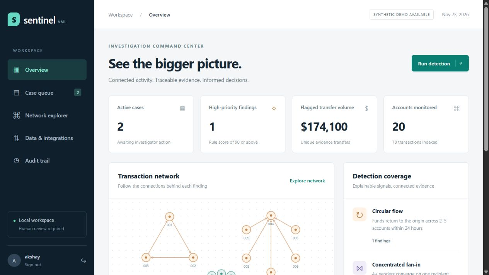
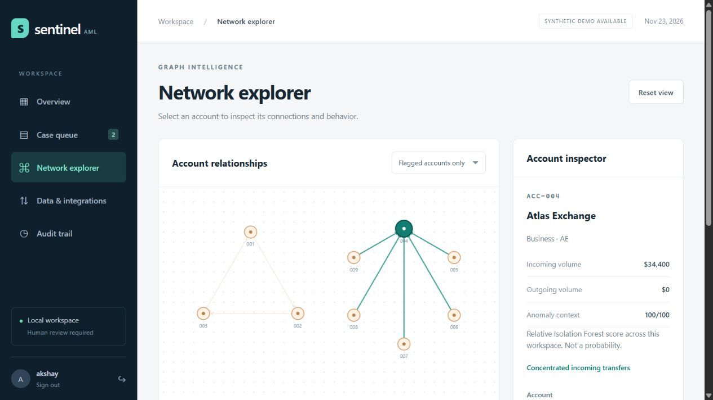
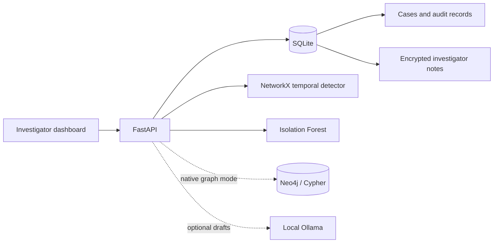

# Sentinel AML

**Follow the money. See the network.**

A full-stack anti-money laundering investigation workbench that turns connected transaction patterns into evidence-backed cases. Investigators can explore a network, inspect the exact transfers behind an alert, assign cases, document a decision, and verify the audit history.



## Run locally

Requires Python 3.11 or 3.12. The default workspace runs entirely on your machine with SQLite, NetworkX, and a local Isolation Forest model. No Docker, cloud account, API key, frontend build, or external database is required for the demo.

On Windows PowerShell, from the project directory:

```powershell
./start.ps1
```

Or run the individual commands:

```powershell
python -m venv .venv
./.venv/Scripts/python -m pip install -r requirements.txt
./.venv/Scripts/python -m uvicorn app.main:app --host 127.0.0.1 --port 8000
```

On macOS or Linux:

```bash
python3 -m venv .venv
.venv/bin/python -m pip install -r requirements.txt
.venv/bin/python -m uvicorn app.main:app --host 127.0.0.1 --port 8000
```

Open [the local workspace](http://127.0.0.1:8000). Create an investigator account with a password of at least 12 characters, then choose **Load demo network**. The fixture contains 20 fictional business accounts, 78 transfers, one three-account circular flow, and one five-sender fan-in. The two patterns generate two cases. Re-running detection preserves existing case decisions and notes.

## Investigation workflow

1. Import account and transfer JSON, or load the fictional demo.
2. Run temporal pattern detection. Review graph-rule scores alongside behavioral anomaly context.
3. Open a case to see every supporting transaction, account, amount, and timestamp.
4. Assign it, move it into review, and add encrypted observations.
5. Escalate or close it with a required decision rationale.
6. Export a JSON case report and verify the hash-chained audit trail.



## Detection and machine learning

| Signal | Implementation | Evidence policy |
| --- | --- | --- |
| Circular flow | Directed cycles across 2–5 distinct accounts | Strictly increasing transfer times, completed within 24 hours, each transfer at least $1,000, and the smallest leg at least 80% of the largest |
| Concentrated fan-in | Rolling incoming 24-hour windows | At least four distinct senders and at least $20,000 total. The highest sender-count window per recipient wins, with volume breaking ties |
| Behavioral anomaly | scikit-learn Isolation Forest, 150 trees, seed 42 | Account features include incoming/outgoing transfer counts, distinct counterparties, totals, and net imbalance. Relative scores are min-max scaled across the current workspace |
| Optional narrative draft | Local Ollama model | Uses account IDs and case evidence. Investigator notes and account names are excluded. A human reviews and edits the draft before saving |

Rule scores (94 and 82) are fixed investigation priorities. Anomaly scores are relative unusualness, with no score produced for fewer than eight accounts. They are not calibrated probabilities. Case generation uses graph rules. The machine-learning score adds review context.

The local cycle search keeps the first qualifying time-respecting transfer path for each account route and initial transfer. It bounds cycle candidates at 10,000 and transfer-search steps at 100,000. The API reports partial results if a bound is reached. All transfers in a selected fan-in window become evidence. These choices trade alert volume and runtime against exhaustive enumeration.

### Native Neo4j mode

Use [Neo4j Desktop](https://neo4j.com/download/) or a dedicated [Aura](https://neo4j.com/cloud/aura/) database. The adapter targets Neo4j 5.26+ and uses parameterized Cypher. Neo4j 5.26 supports Java 17 and 21 when installed from the server ZIP. See the official [system requirements](https://neo4j.com/docs/operations-manual/current/installation/requirements/).

Set environment variables in the terminal before starting Sentinel:

```powershell
$env:NEO4J_URI = 'bolt://localhost:7687'
$env:NEO4J_USER = 'neo4j'
$env:NEO4J_PASSWORD = '<your database password>'
$env:SENTINEL_GRAPH_BACKEND = 'neo4j'
./start.ps1
```

Each detection run mirrors the current accounts and transfers, then executes [circular_flow.cypher](queries/circular_flow.cypher) and [fan_in.cypher](queries/fan_in.cypher) inside Neo4j. Cases, notes, sessions, and audit records remain in SQLite. A connection or query failure produces an explicit error. Set the backend to `local` to use NetworkX again.

**Sync to Neo4j** is also available independently from Data & integrations. Use a dedicated database because the adapter owns the `SentinelAccount` and `SENTINEL_TRANSFER` namespace. Account IDs are unique in that namespace. Detection queries are scoped to the current imported transaction IDs. Local-mode cycle caps and native-mode query caps can select different subsets on large datasets. Native queries have a 30-second timeout and caps of 10,000 cycle paths and 1,000 fan-in windows.

### Optional local AI summaries

Install [Ollama](https://ollama.com/), pull a model, and start Sentinel with its name:

```powershell
ollama pull llama3.2:3b
$env:OLLAMA_MODEL = 'llama3.2:3b'
./start.ps1
```

Open a case and choose **Draft with local AI**. Generated text stays editable and unsaved until you choose **Save reviewed draft as note**. The server calls Ollama at `http://127.0.0.1:11434` by default. Set `OLLAMA_URL` to override it. Response errors are surfaced in the UI.

## Architecture



The frontend is plain JavaScript and CSS with a responsive canvas graph. Searchable case tables, an account selector, and a transaction ledger provide keyboard-accessible alternatives to graph selection. FastAPI serves the UI and API from one origin. SQLite uses WAL mode and atomic write transactions. Optimistic case versions reject stale decisions with HTTP 409. Case fingerprints use the rule and sorted evidence IDs to make repeated detection idempotent.

## Data contract

Download a complete sample from Data & integrations, or generate one:

```bash
python -m scripts.sample
```

```json
{
  "accounts": [
    {"id": "A", "name": "Fictional A", "country": "US", "type": "Business"},
    {"id": "B", "name": "Fictional B", "country": "US", "type": "Business"}
  ],
  "transactions": [
    {"id": "T1", "source": "A", "target": "B", "amount_minor": 125050,
     "currency": "USD", "timestamp": "2026-11-20T09:00:00Z"}
  ]
}
```

Amounts are positive integer USD cents. Timestamps require a timezone and are normalized to UTC. IDs must be unique. Conflicting existing records, unknown account references, and invalid rows roll back the whole import. Identical existing records are accepted. Workspace limits are 1,000 accounts, 5,000 transfers, and a 2 MB request body. The demo uses fixed dates so repeated runs stay reproducible.

## API

Interactive API schema is at `/docs`. All `/api` data routes require a session except session discovery, initial setup, and login. Mutation requests require `X-Sentinel-Request: 1`. Browser sessions use an HTTP-only, SameSite Strict cookie.

| Route | Purpose |
| --- | --- |
| `GET /api/session` | Setup and sign-in state |
| `POST /api/setup`, `/api/login`, `/api/logout` | Account and session lifecycle |
| `GET /api/workspace` | Accounts, transfers, cases, anomaly context |
| `POST /api/import`, `/api/demo` | Atomic import or fictional demo |
| `POST /api/detect` | Create cases for qualifying patterns |
| `GET /api/cases/{id}` | Case evidence and decrypted notes |
| `PATCH /api/cases/{id}` | Versioned decision and assignment |
| `POST /api/cases/{id}/notes` | Encrypt a new note |
| `POST /api/cases/{id}/draft` | Request an optional Ollama draft |
| `GET /api/audit` | Activity history and chain verification |
| `POST /api/neo4j/sync` | Mirror the network to Neo4j |

## Security and deployment boundaries

- Investigator notes and decision rationales use Fernet authenticated encryption. Configure `SENTINEL_ENCRYPTION_KEY` from a secret manager, or the app creates `data/notes.key` locally. Back up the key with the database through a secure process. Losing it makes existing notes unreadable. The local key file shares the machine's trust boundary with the database.
- Passwords use salted scrypt hashes. Session tokens are random, hashed in storage, and expire after eight hours. Ten failed login attempts per source IP trigger a rolling 15-minute limit.
- Cross-origin browser mutations require a custom header and no CORS origins are enabled. The UI escapes imported text and serves a restrictive content security policy.
- Audit hashes detect edits and broken links against the history currently stored. An administrator with database access could rewrite the complete chain. External anchoring would be required for stronger tamper evidence.
- Transaction/account data and case metadata are stored as plaintext in SQLite. Use encrypted disk storage and encrypted backups for those records. Exported case reports include decrypted notes.
- This version supports one investigator identity per workspace and binds to loopback by default. A public deployment needs HTTPS, secure cookies (`SENTINEL_SECURE_COOKIE=1`), managed secrets, stronger operational controls, and a multi-user authorization model. Protect first-run setup before exposing it to a network.
- The fixture and thresholds are educational. This project has no sanctions screening, identity verification, regulatory filing integration, or jurisdiction-specific legal logic. Investigators make all case decisions.

`data/`, `.env`, and `.venv/` are excluded from Git. The tracked `.env.example` documents environment variables and is not loaded automatically.

## Verification

```powershell
./.venv/Scripts/python -m unittest discover -s tests -v
./.venv/Scripts/python -m scripts.evaluate
```

The API tests exercise the case lifecycle, note encryption, login/session protection, rate limiting, atomic import rollback, temporal constraints, idempotency, stale edits, audit tampering, and optional-service error handling. The draft success test uses a mocked Ollama response. GitHub Actions runs the workflow on Windows and Linux.

The seeded smoke benchmark expects two graph findings with exact transaction-ID evidence matches. It is a fixture regression check, not a real-world AML accuracy estimate. Real deployment evaluation would require independently labeled data and threshold calibration.

## Project map

```text
app/main.py            API, authentication, persistence, encryption, case workflow
app/detection.py       Temporal graph rules and Isolation Forest context
app/neo4j_store.py     Neo4j synchronization and native query adapter
app/demo.py            Reproducible fictional transaction network
app/static/            Browser dashboard and canvas network explorer
queries/               Native Cypher detection queries
scripts/               Sample export and reproducible fixture evaluation
tests/                 API and detector behavior checks
.github/workflows/     Windows and Linux CI
```

## Resume description

Built an AML investigation workbench with temporal transaction-graph detection, Isolation Forest anomaly context, evidence-backed case review, encrypted investigator notes, versioned decisions, and a verifiable audit chain. Added a Docker-free local setup and optional native Neo4j and local LLM integrations.
